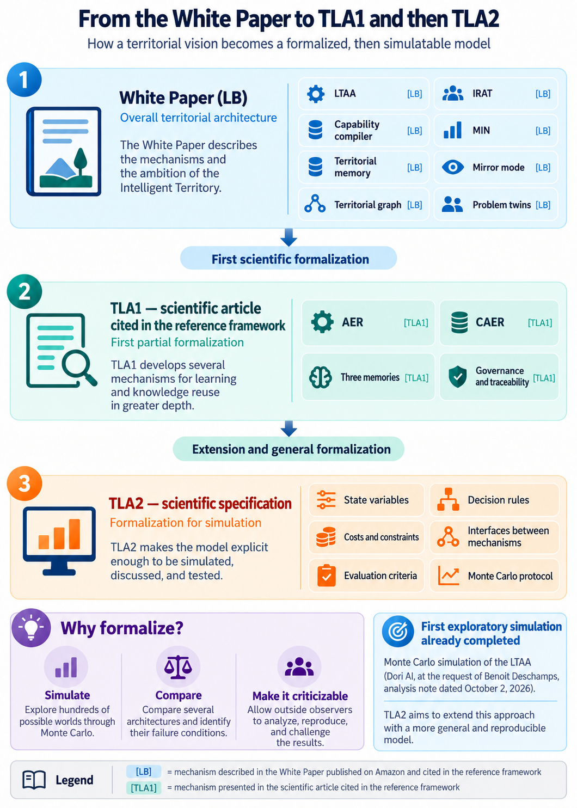

**Reference framework:** Émile Tanic, *Et si l’IA pouvait rendre un territoire plus intelligent ? La Martinique comme territoire apprenant à l’âge de l’intelligence artificielle* (What if AI Could Make a Territory More Intelligent?), 2026, published edition available on [Amazon.fr](https://www.amazon.fr/dp/B0HLHC1MT2), ASIN B0HLHC1MT2. **Scientific starting point:** *TLA — Territorial Learning Architecture: An AI-Assisted Learning Architecture for Territories*, English version EN_v2a, DOI [10.5281/zenodo.22923636](https://doi.org/10.5281/zenodo.22923636).

**Scientific traceability.** Three labels distinguish the origins of the proposals: **[LB]** = a mechanism described in the White Paper published on Amazon and cited in the reference framework; **[TLA1]** = a mechanism presented in the scientific article cited in the reference framework; **[NEW]** = a modeling choice proposed here but not specified in either document. Conceptual correspondence does not mean that an operational algorithm already exists. **The equations below are hypotheses for formalization, not quotations from the White Paper. No new experimental results are claimed.**

# Abstract

This specification proposes a simulatable extension of the *Territorial Learning Architecture* (TLA). The 2026 White Paper describes a *Laboratoire Territorial Auto-Apprenant* (LTAA, Territorial Self-Learning Laboratory) that first uses existing evidence, makes significant uncertainties explicit, compares reversible micro-experiments through the *Indice de Rendement d’Apprentissage Territorial* (IRAT, Territorial Learning Return Index), mobilizes human expertise through the *Martinique Intelligence Network* (MIN), and converts outcomes into documented, governed, transferable capabilities. The first TLA article developed *Adaptive Evidence Routing* (AER), *Context-Aware Experience Reuse* (CAER), and three complementary memories. TLA 2 links these elements within a distributed process subject to human governance and incorporates contextual transfer, the graph of organizations and capabilities, costs, safeguards, and stopping conditions. It specifies a minimal state-transition model, competing policies, indicators defined before simulation, and a Monte Carlo protocol using 800 paired synthetic worlds per scenario. The objective is to identify **potential benefits and failure conditions**, not to forecast economic value for Martinique.

# Introduction — Why formalize the model before simulating it?

The White Paper proposes a territorial development architecture grounded in a central idea: convert observation and experimentation into learning, and learning into lasting capabilities. The scientific article cited in the reference framework identifies and refines several mechanisms for evidence processing and the reuse of experience (AER, CAER, and three memories). This specification, **TLA 2**, seeks to make their interactions with other White Paper mechanisms simulatable, notably LTAA, IRAT, MIN, the capability compiler, and the territorial graph. The purpose is not to rewrite the White Paper: it is to propose a **computational representation** that can be discussed, challenged, and modified.

**The purpose of Monte Carlo simulation** is to expose several competing architectures to the same series of synthetic situations while varying the problems encountered, available resources, costs, reliability of information, accessible experts, and changes in context. This endeavor follows an initial exploratory LTAA simulation conducted by the AI system **Dori**, at the request of **Benoit Deschamps**, and discussed in an analytical note dated 2 October 2026. That initial study used 400 simulated worlds and compared three strategies (a large project, random testing, and IRAT/LTAA logic). Its methodological contribution is to show how territorial learning can be represented through quantitative assumptions, while also underscoring the hypothetical nature of the parameters and the absence of direct empirical validation. TLA 2 seeks to extend that effort through a more general, more transparent, and more reproducible framework. The goal is to compare, under explicitly defined conditions, the ability of different strategies to improve decisions, prevent wasteful spending, retain reusable capabilities, and limit risk. The simulation must also expose situations in which the complete architecture **does not perform better**, is too costly, or produces inappropriate transfers. Its purpose is neither to predict Martinique's actual economic outcomes nor to prove the effectiveness of the system in real conditions.

**Why is formalization essential?** A conceptual description does not automatically determine what a computer program must calculate. State variables, evidence-access rules, possible decisions, costs, effects, learning and transfer mechanisms, random events, and comparison metrics must be specified. Otherwise, a simulation may predominantly measure the programmer's implicit assumptions. Mathematical formulation is therefore a prerequisite for **testability**, not a claim that political and human complexity can be reduced to a single equation.

**Why enable scrutiny by external observers?** Results can be scientifically assessed only if independent teams can separate mechanisms drawn from reference publications from new simulation choices, trace each parameter and its rationale, inspect the assumed distributions and correlations, examine governance rules, reproduce computations, and compare policy outcomes in the same synthetic worlds. The protocol, generated data, code, random seeds, tests, negative results, and sensitivity analyses must be auditable. **Computational reproducibility does not imply empirical validity:** subsequent comparisons with actual territorial data remain indispensable.

Figure 1 clarifies the relationships among the three stages of work. Its arrows indicate a **conceptual mapping**, not exact module equivalence or a demonstrated algorithmic genealogy. The infographic also recalls the earlier exploratory Monte Carlo simulation: an informative precedent, not validation of the general architecture.

{width=95%}

# 1. Purpose, scope, and limits of TLA 2

The research question is: **under what conditions can a human-governed territorial learning architecture improve decision quality, capability accumulation, cost performance, resilience, and fairness relative to simpler decision processes?**

TLA 2 is neither the White Paper's full economic development program nor an autonomous public authority nor an AI delegated responsibility for political choices. It models the mechanisms that support learning under institutional constraints. Martinique motivates its design, but it does not yet supply empirically calibrated parameters. The model must be able to **fail**, incur excessive coordination costs, or recommend an inappropriate transfer.

Three distinct objects must not be conflated: **(a) TIIA**, the overarching model of territorial development [LB, pp. 12–29]; **(b) LTAA**, the distributed decision and learning architecture [LB, ch. 5]; and **(c) TLA 2**, the proposed computational abstraction [NEW] linking selected LTAA functions with TLA1 mechanisms. AER and CAER are not synonyms for LTAA, IRAT, the capability compiler, or MIN.

# 2. Source-traceability matrix

| Mechanism | Commitment in the White Paper | Proposed formalization / TLA1 | Reference | Status |
|:---|:---|:---|:---|:---|
| LTAA | Observe, state uncertainty, generate, filter, compare using IRAT, authorize, measure, compile | State machine coordinating these stages | LB, ch. 5–6, fig. 4, pp. 61–65 | LB → NEW |
| IRAT | Balance information, public value, capability, transfer, money, human time, risk and irreversibility; humans set priorities | Multicriteria ranking of admissible experiments | LB, ch. 7, pp. 66–68 | LB → NEW |
| AER | Choose an evidence source according to uncertainty, cost, risk, and context | Routing policy between documents, experts, experiments, and stopping | TLA1; LB, ch. 6 | TLA1 extended |
| MIN | Arrange bounded, voluntary micro-missions with consent and relevant expertise | Mission queue and human matching | LB, ch. 15, pp. 84–85 | LB → NEW |
| Capability compiler | Preserve context, rights, failures, costs, skills, maintenance, and limits of transfer | Structured, validated capability objects | LB, ch. 8, pp. 69–70 | LB → NEW |
| Three memories | Evidence, consolidated knowledge, and experience | Federated memories with provenance and access rights | TLA1; LB, ch. 14, pp. 82–83 | TLA1 + LB |
| CAER | Reuse, adapt, or reexperiment according to context | Explicit transfer assessment with abstention | TLA1; LB, ch. 26 | TLA1 extended |
| Problem twins | Compare problem signatures rather than superficial resemblance | Contextual distance and validity domains | LB, ch. 26, pp. 129–130 | LB → NEW |
| Territorial graph | Authorized relations among organizations, expertise, data, and capabilities | Typed graph including dependencies and costs | LB, ch. 25, pp. 127–128 | LB → NEW |
| Mirror mode | Compare LTAA recommendations with human practice without automatic action | Separate evaluation stage, confidence thresholds, permissions | LB, ch. 9, pp. 71–72 | LB → NEW |
| Governance | Bounded autonomy, rights, fairness, biosphere, reversibility, continuity | Hard constraints, approvals, vetoes, auditable decisions | LB, ch. 10–13, 17 | LB → NEW |
| Evaluation | Measure services, residual capabilities, resilience, and value | Outcome metrics, ablations, uncertainty, failure tests | LB, ch. 29, pp. 137–139 | LB → NEW |

The reference pages correspond to the published 6 × 9-inch print interior, not to an earlier manuscript layout. TLA1 formalizes selected learning functions, while TLA2 seeks to test their combination with other mechanisms; **a mapping is not a proof of implementation**.

# 3. Minimal formal model of a learning territory

A simulation run includes **organizations** $o\in\mathcal O$, **problems** $p\in\mathcal P$, **contexts** $x\in\mathcal X$, **experts** $h\in\mathcal H$, **capabilities** $c\in\mathcal C$, and time points $t=0,\ldots,T$. The true properties $\theta$ of a problem are hidden from the decision policy but available to the simulator for error evaluation.

The observed state is represented as:

$$
S_t=\left(P_t,B_t,M_t^{E},M_t^{K},M_t^{X},C_t,H_t,G_t,Z_t,Q_t\right).
$$

Here, $B_t$ denotes resource budgets; $M_t^E$ evidence memory; $M_t^K$ consolidated-knowledge memory; $M_t^X$ experience memory; $C_t$ compiled capabilities; $H_t$ human skills and availability; $G_t$ the territorial graph; $Z_t$ governance and access rules; and $Q_t$ assessed learning-policy quality. Each problem has an outcome indicator and a context signature $x_p$ (organizational, environmental, legal, human, and technical factors).

Evolution is modeled by:

$$
S_{t+1}\sim P_{\varphi}\!\left(\,\cdot\mid S_t,a_t,\omega_t\right),
\qquad a_t\sim\pi(\cdot\mid S_t),
$$

where $a_t$ is the action, $\pi$ the policy, $\omega_t$ external events, and $\varphi$ the scenario parameters. This is a controlled, partially observed stochastic process, **not** a claim that political choices are reducible to optimization.

Essential distinctions are maintained: an observation is not a belief; correlation does not automatically imply causation; a memorized resource is not necessarily legally accessible; a recorded experiment is not yet a validated capability; and every reuse is a new decision that may require another micro-experiment.

# 4. Modules, interfaces, and control mechanisms

## 4.1 Problem registration and mandate [LB → NEW]

**Inputs:** documented problem, accountable organization, stakeholders, intended outcomes, baseline, rules, and available data. **Output:** a *ProblemCase* specifying a falsifiable question, eligible actions, safety constraints, uncertainties, and an authorized experimentation envelope. An inadequately specified case may be rejected. Human authorities determine goals and thresholds; the model does not invent them.

## 4.2 AER — adaptive evidence routing [TLA1 → NEW]

**Inputs:** decision case, current belief $b_t(\theta)$, memories, and accessible sources. **Output:** a selected route $r$: reuse an existing record, search for additional data, consult MIN, run a reversible micro-experiment, stop information gathering and act, abstain, or seek an institutional decision.

For a source $r$, a preliminary definition of **expected value of information for decision making** is:

$$
\operatorname{EVI}(r)=
\mathbb E_{y\mid r,D_t}\!\left[
\max_{a\in\mathcal A}\mathbb E\!\left[U(a,\theta)\mid D_t,y,r\right]
\right]
-\max_{a\in\mathcal A}\mathbb E\!\left[U(a,\theta)\mid D_t\right].
$$

$D_t$ denotes existing evidence, $y$ the yet-unknown observation supplied by $r$, $\mathcal A$ admissible actions, and $U$ their public utility. The policy compares this value with the **full cost of information**, subject to constraints:

$$
\operatorname{NetGain}(r)=\operatorname{EVI}(r)-C_{\mathrm{info}}(r).
$$

Information is not acquired when its expected marginal gain is insufficient or its access is forbidden. Expensive new infrastructure is not the default starting point. AER can delegate the ranking of admissible micro-experiments to IRAT. **These equations are new**; they are not prescribed by the White Paper. The estimator's calibration and overconfidence must be tested. AER must be able to conclude that further information seeking is unnecessary.

## 4.3 IRAT — transparent multicriteria comparison [LB → NEW]

For each reversible, admissible experiment $e$, define:

$$
z(e)=\bigl(I_e,V_e,K_e,T_e,C_e,H_e,R_e,J_e,E_e,D_e\bigr),
$$

representing information gain, public value, residual capability, transferability, financial cost, scarce human hours, risk, irreversibility, ecological burden, and delay, respectively. Legal and safety constraints are checked **before** ranking. Human decision makers define the weights, normalization bounds, vetoes, and the legitimacy of trade-offs.

One possible experimental score is:

$$
\operatorname{Score}_{w}(e)=
\sum_{j\in\mathcal B}w_j\,\operatorname{norm}\!\left(z_j(e)\right)
-\sum_{k\in\mathcal N}w_k\,\operatorname{norm}\!\left(z_k(e)\right),
\qquad e\in\mathcal E_{\mathrm{admissible}}.
$$

$\mathcal B$ covers benefit criteria and $\mathcal N$ burdens. **This score is not a definitive IRAT formula**: the White Paper expressly rejects a magical single score. The interface must display uncertainty intervals and Pareto alternatives. Rights and ecological limits cannot be converted into negotiable penalties. Weight changes can reverse rankings and must be reported. Reusable future effects are uncertain and cannot be double-counted.

## 4.4 MIN — bounded human micro-expertise [LB → NEW]

**Mission object:** question, problem signature, required skills, sensitivity, bounded duration, consent, possible compensation, deadline, and accountable party. **Matching inputs:** volunteers' declared expertise, availability, permitted information, and recognition terms. **Outputs:** accepted or rejected mission, delay, cost, validated observation, and estimated reliability. Failed matching, nonresponse, and disagreement among experts remain possible. The diaspora cannot be assumed to provide unlimited, free expertise. MIN should be compared with ordinary procurement of remunerated expertise.

## 4.5 Execution and independent assessment of experiments [LB → NEW]

Perform a limited, reversible, explicitly authorized intervention. Record the baseline, intervention, outcomes, harms, human time, deployment cost, protocol deviations, and decision consequences. Independent assessment determines whether beliefs should be updated, replication is needed, or the intervention should stop. **Negative and inconclusive trials are retained.** The simulator will include biased measurements, uninformative experiments, irreversibility, and unintended effects.

## 4.6 Capability compiler [LB → NEW]

**Input:** evaluated experience (positive, negative, or ambiguous) with provenance. **Output:** a validated *CapabilityObject*, or merely an *ExperienceRecord* not promoted to capability status—never a costless benefit. A capability object documents at least the problem and context, hypotheses, data and access rights, protocol, measured results and errors, skills, tools and scripts, reproducibility, security, operating constraints, limits of transferability, maintenance owner, version, review date, and access regime (open, shared, restricted, or protected).

Promotion requires a minimum evidence quality, an identified owner, and maintenance resources. A capability may lose validity, be withdrawn, or fail upon reuse. Compilation includes validation costs **and** recurring maintenance. A schematic representation of persistence is:

$$
q_c(t+1)=q_c(t)\,\bigl(1-\delta_c(t)\bigr)+\Delta q_c(t),
$$

where $q_c(t)$ is a conventional validity measure, $\delta_c$ is degradation, and $\Delta q_c$ reflects possible revalidation. **This degradation equation is a new proposal**, not an equation found in the White Paper.

## 4.7 CAER, problem twins, and territorial graph [TLA1 + LB → NEW]

CAER locates a candidate capability or experience $c$ and compares its validity domain with a new context $x$. A transparent contextual distance can be written as:

$$
d(x,x_c)=\sum_{j=1}^{m}\alpha_j\,d_j(x_j,x_{c,j}),
\qquad \sum_{j=1}^{m}\alpha_j=1,
$$

**subject to** noncompensatory legal and safety conditions. High similarity is not sufficient on its own. CAER proposes **reuse / adapt / reexperiment / abstain**, supported by a prediction interval and rationale. A transfer is a **new experiment**, not guaranteed reuse. Failures and counterexamples update the validity domain.

The graph $G_t$ contains typed nodes (organizations, experts, data custodians, processes, methods, capabilities) and authorized relations (access, dependency, cooperation, transfer). A path does not automatically confer access rights. Creating and maintaining links generates cost, delay, and failure. Cooperation may lower future costs, while dependencies and lock-in may increase them. Network effects are **empirical hypotheses to test**.

## 4.8 Mirror mode and bounded autonomy [LB → NEW]

**Stage 0:** parallel recommendations compared with experts, with no automated action. **Stage 1:** human-conducted experiments, potentially informed by model recommendations. **Stage 2:** automation only for validated, low-risk, reversible tasks. High-consequence decisions remain subject to designated human approval. Stage transitions require prespecified thresholds for decision quality, calibration, harm, fairness, and audit completeness. Failure triggers suspension or a return to an earlier level. Human oversight must remain comparable across simulated strategies.

# 5. Causal integration and central hypothesis

Proposed flow: **register problem → check constraints → select evidence source through AER → optionally search through CAER → optionally rank experiments with IRAT → optionally consult MIN → authorize an experiment or action → assess independently → update evidence and experience memories → optionally compile capability → update graph → monitor, retire, or resume learning**.

Parallel deliberations and loops are permitted; no problem must pass through every step. Existing evidence can suffice for a decision without any new experiment.

The central hypothesis is **conditional and falsifiable**: where related problems recur, information can be acquired at acceptable cost, and contextual relevance is reliably assessed, adaptive routing, governed compilation, and contextual reuse may improve cumulative outcomes compared with simpler policies. Conversely, the complete architecture may perform worse under rapid contextual drift, poor expert matching, high maintenance costs, little reuse, restricted access, or unreliable evidence.

# 6. Monte Carlo protocol: 800 paired worlds

Before detailing the general protocol, TLA 2 should be distinguished from the prior exploration. The Dori/LTAA simulation, requested by Benoit Deschamps and analyzed in the 2 October 2026 note, is a **methodological precursor**: it compares three strategies over 24 months, under a €1.5 million budget and a ten-year value horizon, across 400 simulated worlds. Its main contribution is not proof of an actual LTAA advantage, but an example of converting sequential experimentation, uncertainty reduction, and the reuse of lessons learned into testable quantitative assumptions. TLA 2 extends the scope: it specifies additional mechanisms, incorporates governance rules, strengthens assumption traceability, and structures policy comparisons for independent re-execution.

## 6.1 Simulation unit and common worlds

Use **800 synthetic worlds per prespecified scenario** (not 800 municipalities). Within each world, policies encounter the same underlying stream of hidden problems, contextual and institutional shifts, experts, data sources, and potential outcomes. Exogenous events use common random draws, while policy-dependent consequences must still obey the specified stochastic mechanisms. Episodes should be long enough to reveal capability persistence and obsolescence—for example, 60 time periods with recurring problem families (**illustrative choices**, not observed facts). Prespecified parameters must be distinguished from those needing empirical calibration.

## 6.2 Competing policies and ablations

| Code | Policy | Isolated research question |
|:---|:---|:---|
| P0 | Conventional process with human controls, no shared learning layer | Credible baseline |
| P1 | P0 + AER and targeted evidence gathering | Value of selectively acquired information |
| P2 | P1 + IRAT experiment ranking | Benefit of adaptive prioritization |
| P3 | P2 + MIN and bounded micro-missions | Access to expertise net of time and cost |
| P4 | P3 + capability compiler and governed memories | Residual capability net of maintenance |
| P5 | P4 + CAER, problem twins, and graph-based transfer | Marginal value of context-aware reuse |
| P6 | P5 + improvement of the **learning policy itself** after independent assessment | Learning to learn |

P1–P6 are proposed experimental architectures [NEW]. In addition, each component must be removed from P5 in turn, and CAER compared with naive reuse lacking contextual safeguards. An AER + CAER configuration without a compiler must use an explicitly defined reference repository, not fictitiously free capabilities. Outcome functions, budgets, and human safeguards remain comparable across policies.

## 6.3 Stress-test scenarios

**A. Stable and recurring:** related problems, moderately reliable evidence, transfer opportunities. **B. Rapid contextual drift:** changing relationships and misleading analogies that challenge CAER. **C. Scarce human expertise:** limited availability, delays, increased opportunity cost of expert time. **D. Expensive compilation and maintenance:** low reuse, costly validation, and obsolescence. **E. Institutional fragmentation:** denied access, broken graph links, and data-protection limits. **F. Asymmetric severe harms:** rare high-impact events requiring mandatory vetoes. Run **800 paired worlds for each** of the six scenarios after protocol registration. A debugging pilot must not be presented as confirmation.

## 6.4 Outcomes and mandatory constraints

**Primary endpoints (a small prespecified set):** (i) mean net service utility after direct and indirect costs; (ii) lower-tail results, the P10 percentile, and average loss beyond a predefined adverse threshold; (iii) full monetary and human-time cost per useful learning event that changes a decision; and (iv) validated benefits of capability reuse net of maintenance. **Secondary endpoints:** severe errors, delays, expert hours, coverage and fairness across groups, ecological footprint, incorrect transfers, decision calibration, independent audits, recovery after service disruption, organizational participation and exit, and graph coordination cost. Report them separately rather than hiding them in a single territorial “intelligence” score.

**Hard constraints:** legal prohibitions, safety, human authorization for consequential decisions, access permissions, ecological thresholds, and protections for vulnerable populations. A prohibited action is not simply assigned a monetary penalty: it is inadmissible or recorded separately as a governance violation.

## 6.5 Statistical analysis

For each scenario and each world $i$, compute **paired differences**:

$$
\Delta_i=Y_i(P5)-Y_i(P0),\qquad i=1,\ldots,800,
$$

as well as P5–P4 and P5–P2 comparisons. Report the mean and median differences, a 95% interval computed using a *paired bootstrap over worlds*, P10/P90 percentiles, and harm distributions; apply binomial uncertainty intervals to rare-event frequencies. Repeat using multiple independent random seeds.

Monte Carlo variance can be reduced by increasing the number of worlds, **without thereby validating the assumptions**. Sensitivity analyses must identify breakpoints related to evidence noise, problem recurrence, expert delay, compiler cost, transfer error, and governance overhead. Primary comparisons are specified in advance; secondary explorations are labeled accordingly. The probability of **inferior performance** should also be measured. A confidence interval cannot repair an incorrectly specified model.

## 6.6 Refutation criteria

The hypothesis of complete-system superiority fails, for the scenario under study, if net public value does not increase, costs absorb reuse benefits, harms or inequalities exceed thresholds, or governance constraints are violated. **Learning to learn** is unsupported if P6 does not improve out-of-sample performance relative to P5 on comparable problem streams. The compiler's cumulative return is unconfirmed if reuse benefits do not cover compilation and maintenance. AER should underperform a simple method when information costs exceed their contribution to decisions. Such negative outcomes are scientifically valid results.

# 7. Implementation requirements and open questions

**Required executable components:** world generator; problem/context signatures; belief updating; simulators for documentary sources, experts, and micro-tests; safety filtering; AER; IRAT; MIN matching; evaluated outcomes; compiler and degradation; governed memories; CAER and transfer restrictions; graph; resource accounting; comparator policies; paired execution; reproducible figures and CSV/Parquet tables. Every random variable must have a distribution, defined correlations, and units. Any economic “value” must be defined without double counting.

**Open design choices:** real measurement of public value and trade-offs across groups; IRAT normalization and weights; legal feasibility of data exchange; decisions about releasing learning as a commons; reference truth for identifying “useful learning”; expert reliability and availability; calibration of contextual distance; the graph's causal contribution; financial horizon and discounting; comparisons with existing institutions. Monte Carlo alone cannot settle these matters.

# 8. Verification, reproducibility, and limits of validity

For independent assessment, the implementation must release variable definitions, distributions and correlations, units, parameters, software configuration, random seeds, decision logs, and complete results, including failures. Unit tests must verify the absence of prohibited actions, budget overruns, leaks of hidden ground truth to decision policies, and free or provenance-free reuse.

Verification should begin with small analytically tractable worlds: free or perfect information, unavailable sources, unrelated contexts, and unavailable experts. It must distinguish software defects from results unfavorable to the model. Paired differences must reproduce across multiple seeds; sensitivity analyses must actively seek performance breakpoints. Public-value choices, access rules, and governance decisions must be documented rather than portrayed as neutral algorithm properties.

Successful computational reproduction validates neither the assumed distributions nor actual economic effects. Empirical calibration requires at least one bounded territorial demonstrator and an independent comparison against existing practice. Thus, whether the architecture is effective remains an open empirical question.

# 9. Conclusion

TLA 2 proposes an explicit computational integration of adaptive evidence routing (AER), multicriteria selection of micro-experiments (IRAT), targeted human expertise (MIN), governed compilation of experiences, and context-aware experience reuse (CAER). It distinguishes concepts originating in the White Paper, mechanisms already developed in TLA1, and additional assumptions needed for computational representation. The intended contribution lies less in any isolated algorithm than in their interactions, costs, abstention options, and limits on autonomy subject to human responsibility.

The initial Monte Carlo simulation carried out with Dori at Benoit Deschamps's request illustrates the value of preliminary quantitative exploration as well as the need for an explicit, verifiable protocol. This article defines a framework for comparing competing policies within shared synthetic worlds, assessing their net effects, and identifying failure conditions. **It reports no new simulation results and does not claim empirical proof of effectiveness.**

Its contribution is therefore a **falsifiable theoretical specification**, designed to enable implementation, independent scrutiny, and later confrontation with observed territorial data. Its scientific value will depend as much on the unfavorable results it makes possible as on any improvements it helps identify.

# 10. Bibliographic references

1. **Tanic, Émile.** *Et si l’IA pouvait rendre un territoire plus intelligent ? — Martinique Territoire Intelligent.* Published edition, 2026, 6 × 9-inch print format, [Amazon.fr, ASIN B0HLHC1MT2](https://www.amazon.fr/dp/B0HLHC1MT2). Pages cited here: 12–29 (TIIA model); 61–72 (LTAA, IRAT, compiler, mirror mode); 74–88 (governance, memories, MIN); 127–130 (graph and problem twins); 137–139 (evaluation). Kindle locations can vary by device.
2. **Tanic, Émile.** *TLA — Territorial Learning Architecture: An AI-Assisted Learning Architecture for Territories.* English EN_v2a, September 2026. DOI: <https://doi.org/10.5281/zenodo.22923636>. Starting point for this specification: AER, CAER, and three organizational memories.
3. **Dori** (an AI system created by Benoit Deschamps), simulation carried out at the request of **Benoit Deschamps**. Results presented and discussed in *Simulation Monte-Carlo du LTAA — Comprendre la méthode, lire les résultats et apprécier leur portée* (LTAA Monte Carlo Simulation — Understanding the Method and the Scope of Its Results), analytical note dated 2 October 2026, shared within this project. Three strategies are compared in 400 simulated worlds; this is a methodological precursor, not empirical validation of the general model.
